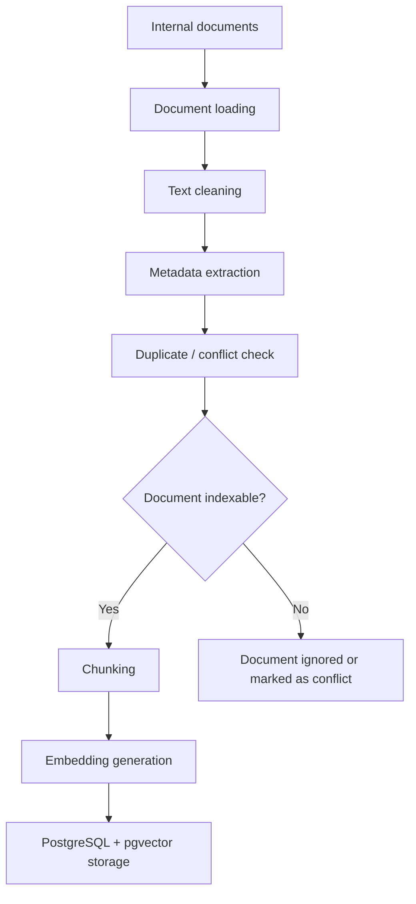
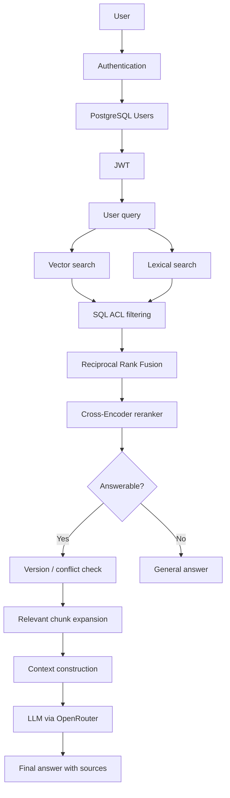

# Nattu RAG Assistant

Enterprise RAG assistant that allows Nattu Industries employees to query internal documentation in natural language, with authentication, access control, hybrid retrieval, reranking, and source-grounded answers.

## Objective

This project simulates a realistic enterprise RAG use case.

The system can:

- ingest and index internal documents
- extract document metadata
- detect duplicates and version conflicts
- split documents into chunks
- generate and store embeddings
- perform hybrid vector and lexical retrieval
- merge rankings using Reciprocal Rank Fusion
- rerank results with a Cross-Encoder
- manage document versions
- detect ambiguous or insufficient answers
- authenticate users
- filter documents according to user permissions
- generate source-grounded answers with an LLM
- expose the system through Streamlit and FastAPI.

---

## Architecture

The project contains two main workflows.

### Document indexing workflow



### User query workflow



---

## Access Control

Each user has:

- a department
- a role
- an active/inactive status.

Documents also contain a department and a classification level.

Current access rules:

| Classification | Access |
|---|---|
| `public` | All users |
| `internal` | All employees |
| `restricted` | Users from the same department |
| `confidential` | Administrators only |

Access filtering is performed directly in the PostgreSQL queries used for vector and lexical search.

An unauthorized chunk therefore never reaches the RRF stage, the reranker, or the LLM.

```text
User
  ↓
department + role
  ↓
SQL ACL
  ↓
Authorized chunks only
  ↓
RRF
  ↓
Reranker
  ↓
LLM
```

---

## Authentication

Users are stored in PostgreSQL.

Passwords are never stored in plain text. They are hashed using `bcrypt`.

The API then uses JWT tokens.

```text
Username + Password
        ↓
PostgreSQL
        ↓
bcrypt verification
        ↓
JWT
        ↓
Authorization: Bearer <token>
        ↓
Authenticated user
        ↓
RAG with ACL
```

The token is used to identify the user, while role and department information are retrieved from the database.

---

## Hybrid Retrieval

The retrieval pipeline combines two complementary approaches.

### Vector Search

The user query is converted into an embedding using:

```text
sentence-transformers/paraphrase-multilingual-MiniLM-L12-v2
```

Embeddings are stored in PostgreSQL using `pgvector`.

Cosine similarity is used to identify chunks that are semantically close to the query.

### Lexical Search

PostgreSQL Full-Text Search runs in parallel to retrieve chunks containing relevant query terms.

### Reciprocal Rank Fusion

The vector and lexical rankings are merged using Reciprocal Rank Fusion.

```text
Vector Search ──┐
                ├── RRF ──> merged ranking
Lexical Search ─┘
```

### Reranking

The top candidates are then evaluated using a Cross-Encoder:

```text
cross-encoder/mmarco-mMiniLMv2-L12-H384-v1
```

The reranker directly evaluates:

```text
[query, chunk]
```

to produce a more accurate ranking.

---

## Document Management

The indexing pipeline handles:

- document ID;
- version;
- department;
- classification;
- status;
- language;
- date;
- source.

The system can also detect:

- duplicate documents
- conflicting documents
- explicitly requested versions
- conflicts involving the latest document version.

---

## Answer Generation

The LLM is accessed through OpenRouter.

The model receives only the context selected after:

```text
ACL
→ Hybrid Search
→ RRF
→ Reranking
→ Answerability
→ Version / Conflict Check
→ Context
```

When an internal answer is available, the LLM must answer only from the provided context.

Document-based answers include references to the sources used.

---

## API

The RAG engine is exposed through FastAPI.

### Endpoints

| Method | Endpoint | Description |
|---|---|---|
| `GET` | `/health` | Checks API availability |
| `POST` | `/login` | Authenticates a user and returns a JWT |
| `GET` | `/me` | Returns the currently authenticated user |
| `POST` | `/chat` | Queries the RAG assistant |

### Run the API

```bash
poetry run uvicorn api:app --reload
```

The API is available at:

```text
http://127.0.0.1:8000
```

Swagger documentation is available at:

```text
http://127.0.0.1:8000/docs
```

### Example request

```json
{
  "query": "What is the response time for a critical incident?"
}
```

Example response:

```json
{
  "status": "success",
  "answer": "The required response time is...",
  "sources": [
    {
      "document_id": "SUP-SLA-008",
      "version": "2026.1",
      "start_page": 1,
      "end_page": 1
    }
  ]
}
```

---

## Streamlit Interface

A Streamlit interface is also available for direct interaction with the chatbot.

It includes:

- user login
- role and department display
- conversation history
- RAG answers
- source display
- logout.

Run the application with:

```bash
poetry run streamlit run app.py
```

---

## Technical Stack

### Backend

- Python 3.13
- FastAPI
- Streamlit

### Database

- PostgreSQL
- pgvector

### AI / NLP

- Sentence Transformers
- Cross-Encoder
- OpenRouter
- LLM

### Security

- bcrypt
- JWT
- role-, department-, and classification-based ACL

### Data Processing

- Pandas
- NumPy
- PyMuPDF
- python-docx
- RapidOCR

### Engineering

- Poetry
- Pytest
- Git
- GitHub Actions

---

## Installation

### Clone the repository

```bash
git clone https://github.com/abd-29/Nattu.git 
cd Nattu
```

### Install Poetry

```bash
pipx install poetry
```

### Install dependencies

```bash
poetry install
```

---

## Configuration

Create a `.env` file at the project root.

Example:

```env
DB_HOST=localhost
DB_PORT=5433
DB_NAME=novatech
DB_USER=postgres
DB_PASSWORD=your_password

OPENROUTER_API_KEY=your_openrouter_key
API_SECRET_KEY=your_jwt_secret
```

The `.env` file must never be committed to the repository.

Add it to `.gitignore`:

```gitignore
.env
```

---

## JWT Secret Generation

A JWT secret can be generated with:

```bash
python -c "import secrets; print(secrets.token_hex(32))"
```

Then add it to `.env`:

```env
API_SECRET_KEY=...
```

---

## Tests

Tests are executed with Pytest.

```bash
poetry run pytest
```

The test suite focuses mainly on critical components:

- password hashing and verification
- access control rules
- Reciprocal Rank Fusion
- document version extraction.

---

## CI

The project uses GitHub Actions.

On every:

```text
push to main
or
pull request to main
```

the CI pipeline runs:

```text
Checkout repository
        ↓
Python 3.13
        ↓
Poetry installation
        ↓
Dependency installation
        ↓
Python syntax validation
        ↓
Pytest
```

The workflow is defined in:

```text
.github/workflows/ci.yml
```

Required secrets are configured using GitHub Actions Secrets and are never stored directly in the repository.

---

## Project Structure

```text
Nattu/
├── .github/
│   └── workflows/
│       └── ci.yml
├── data/
│   ├── raw/
│   └── processed/
├── docs/
│   └── workflow.md
├── src/
│   ├── auth/
│   │   ├── user.py
│   │   └── user_repository.py
│   ├── chunking/
│   │   └── text_chunker.py
│   ├── embeddings/
│   │   └── embedding_model.py
│   ├── generation/
│   │   └── answer_generator.py
│   ├── indexing/
│   │   ├── indexing_pipeline.py
│   │   └── index_state.py
│   ├── ingestion/
│   │   ├── document_loader.py
│   │   └── manifest.py
│   ├── processing/
│   │   ├── document_processor.py
│   │   └── metadata_extractor.py
│   ├── retrieval/
│   │   ├── hybrid_search.py
│   │   ├── retrieval_utils.py
│   │   └── reranker.py
│   └── vectorstore/
│       ├── chunk_repository.py
│       └── database.py
├── tests/
├── api.py
├── app.py
├── config.py
├── poetry.lock
├── pyproject.toml
└── README.md
```

---

## Security Principles

The project implements several security principles:

- password hashing;
- JWT authentication;
- token expiration;
- database-side user verification;
- inactive account handling;
- access control before reranking;
- unauthorized documents are never sent to the LLM;
- API keys are stored in environment variables;
- GitHub Secrets are used for CI/CD.

---

## Current Limitations

This project is designed as an enterprise RAG architecture simulation.

Possible future improvements include:

- refresh tokens;
- centralized JWT revocation;
- finer-grained permissions by document or group;
- observability and metrics;
- rate limiting;
- cloud deployment of the API;
- RAG performance monitoring;
- integration tests using a dedicated PostgreSQL database;
- user administration through a dedicated interface.

---

## Version

```text
Nattu RAG API v2.0.0
```

Nattu combines document retrieval, access control, generative AI, and API exposure in a RAG architecture designed for enterprise use.
